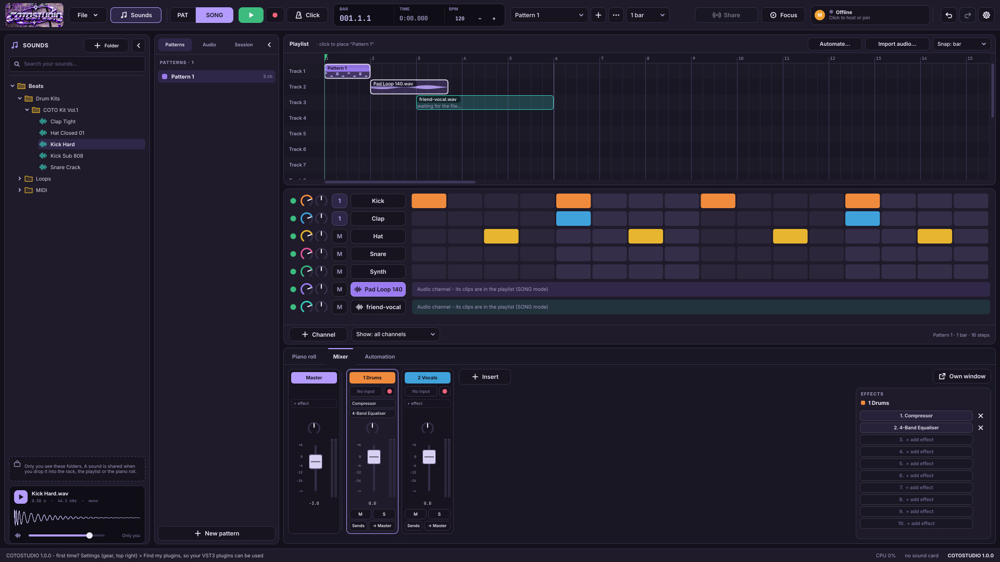

# COTOSTUDIO — make music together, in sync

A multiplayer, FL-style DAW for Windows. Several people work on the **same song at
the same time**, each on their own PC, each using their own **VST3 and VST2 plugins**
(Waves, FabFilter, Omnisphere...). Friends connect over **Tailscale** (or the same Wi-Fi).



Free software under the **GNU AGPLv3** (see `LICENSE`), built on
[Tracktion Engine](https://github.com/Tracktion/tracktion_engine) (GPLv3) and
[JUCE](https://juce.com) (AGPLv3). Formerly called *SyncTest*.

## Download and first start

1. From the newest release, download **COTOSTUDIO.exe** (or the zip with the
   README and licences) and run it. Windows may say it doesn't know the app:
   *More info → Run anyway*.
2. If you used SyncTest before, the first start **moves its files off C:** into
   the new data folder (a window shows the progress): your songs, takes, backups,
   settings and plugin list. Nothing is lost; a file is only removed from its old
   place once its copy is complete.
3. The first time, open **Settings** (the gear, top right) → **Find my plugins
   (VST3, VST2)...** → *Options → Scan for new or updated VST3 plug-ins* (the default
   folder `C:\Program Files\Common Files\VST3` is where Waves and FabFilter
   install), then *Scan for new or updated VST plug-ins* for your VST2 plugins (VST =
   VST2; it looks in the usual VST2 folders, and you can add the one where you keep
   yours, e.g. Omnisphere's). *Waves:* make sure Waves Central installed the VST3
   "WaveShell" files.
4. **Settings → Sound card and MIDI...** picks your audio interface (ASIO for the
   lowest delay, e.g. *UMC ASIO Driver* on a Behringer).

## What's new in 1.12.1

* **Right-click an audio clip → Make unique**, like FL: the clip gets its own
  channel (named "take 1 #2", same file, insert, volume and pan), so it can go
  through another insert than the clips it was duplicated from.
* **Moving a duplicated clip to a track that goes to another insert does this
  for you**: before, the copy and the original shared one channel, so moving
  the copy re-routed the original too. Now the original keeps its insert and
  the status bar says the copy got its own channel. Copies moved to tracks
  going to the same insert (or to tracks linked to no insert) stay as they are.

## What's new in 1.12

* **Your recording template comes over complete.** Four new effects of our own stand in
  for the FL effects it was missing, and an FL import gives them **your settings**:
  * **Compressor** (for Fruity Compressor): threshold, ratio, gain, attack, release and
    the type (Hard ... Soft, and RMS versions that follow loudness rather than peaks).
  * **Enhancer** (for Soundgoodizer): one Amount knob and four flavours, A-D. It makes a
    sound fuller and louder by bringing quiet parts of its lows, mids and highs up, with
    a safety limiter at the end. It's our own take, not a copy of Soundgoodizer: check it
    by ear.
  * **Flanger** (for Fruity Flangus): order (how many swept copies), depth, speed,
    delay, stereo spread, cross feedback, and dry / wet that can go below zero.
  * **Filter** (for Fruity Love Philter): a resonant filter (1-3 stages) with low / band
    / high mix, input and output volume and pan. Only the Love Philter's first unit
    comes over (its envelopes and other units don't).
  * **Fruity Limiter** now also comes with its settings (limiter, compressor and the
    noise gate your vocal chains use).
  * FL's **mix knob** of an effect slot (e.g. Flangus at 33%) now goes into our Delay's,
    Reverb's and Flanger's dry / wet.
  * All of them are in the mixer's *Built-in* list too. The engine's plain compressor is
    now called *Compressor (simple)*.
* **Track buttons on the playlist, like FL's:** each track has
  * **Arm** (the dot): Rec records your input on this track, through the track's insert
    (the insert with the track's name, or the one chosen in its right-click menu). The
    first time it asks which insert and which input.
  * **Monitor** (the speaker): hear your input through that insert while recording, or
    not (crossed out = off, e.g. when your interface's direct monitor already lets you
    hear yourself). Arm and monitor are this PC's own, like your mic.
  * **Mute** (the green light): click mutes or unmutes the track; right-click solos it
    (only it plays), and right-click again brings every track back.
* **Fixed:** *Create automation clip* on the master's volume or pan did nothing (the
  master's knobs have other names inside the engine). Now it makes the clip, and the
  master follows it in SONG mode.

## What's new in 1.11

* **VST2 plugins** load too, like VST3 ones: instruments (Omnisphere...) and effects.
  Scan them once in **Settings → Find my plugins (VST3, VST2)...** → *Options → Scan
  for new or updated VST plug-ins* (VST = VST2). They save with the song, their knobs
  sync between PCs like any plugin's, and each PC needs them installed to hear them.
  * **FL beat import:** a plugin FL used as VST2 now comes in as that same VST2 with
    **its exact sound** (FL's saved patch), e.g. Omnisphere. If it wasn't scanned yet,
    COTOSTUDIO loads it from where FL had it. Without the VST2, its VST3 version is
    used as before.
* **The channel rack and the piano roll float, like FL's windows.** They sit over the
  playlist, and you move them anywhere by their title bar and size them from any edge
  or corner. The playlist gets the whole height behind them.
  * **F6** (rack), **F7** (piano roll), or the window buttons in the top bar show or
    hide them. **x** hides one. A click brings a window to the front.
  * **Double-click the title bar** (or its full-screen button) to fill the space, and
    again (or **Esc**) to go back.
  * Each panel's window button (the arrow icon; *Window...* on the mixer) chooses
    where it goes: **in the main window** (as before), **floating** (like FL), or **in
    a window of its own** (e.g. your second screen). The mixer can float too.
  * Where they are and their sizes are remembered on your PC.
* **The playlist zooms out much further** (Ctrl + mouse wheel): down to 4 pixels a
  bar, so a whole song fits on the screen. Bar numbers and grid lines thin out as you
  zoom out.
* **FL beat import brings your FL effects' settings.** Fruity Delay 3, Fruity Reeverb 2
  and Fruity Parametric EQ 2 come in as COTOSTUDIO's Delay, Reverb and Parametric EQ
  **with your settings**: delay time (tempo sync), feedback, filter, wet / dry, model,
  distortion...; reverb size, decay, pre-delay, cuts, damping, wet / dry; EQ bands
  (type, frequency, level, width) and main level. (Worked out from FL projects with
  every knob at its default, minimum and maximum, and checked against a real hi-hat
  delay.) Fruity Limiter still starts from its defaults.

## What's new in 1.10

* **808s (and any sampler sound) can stop when their note ends.** Turn on **Note
  length** in the channel's *Edit sound* window, or right-click the channel → *Stop at
  note end*. Then a short note plays a short 808, a long note a long one (a 10 ms fade,
  no click). It works together with *Cut itself*. Off (the default), the whole sound
  plays however short the note is, which is what you want for drums from the step
  sequencer.
* **Window buttons in the top bar** (like FL's): **Playlist**, **Channel rack**,
  **Piano roll**, **Mixer**. The one you're looking at lights up.
  * With the **piano roll full screen**, the **Channel rack** button (or **F6**) shows
    the rack above it, and hides it again. You can switch instruments or tweak steps
    without leaving full screen.
  * **Playlist** leaves the piano roll's full screen.
* **Import your FL Studio beats** (File → *Import an FL Studio project (.flp)...*). Your
  project comes in as a new song:
  * **Channels:** sampler sounds, and VST3 instruments (Serum 2, ZENOLOGY, JV-1080...)
    **with the sound you had picked**. A channel whose VST2 isn't hosted here gets its
    VST3 version, with FL's settings offered to it (Omnisphere keeps its patch this way
    when the plugin accepts it). Volume, pan, and the mixer insert each channel plays
    through come too.
  * **Patterns with all their notes** (velocity, pan, fine pitch, release), up to 32
    bars long (patterns can now be 16 or 32 bars).
  * **The playlist:** every pattern clip and audio clip where you had it, trims
    included, on the same tracks, with the track names and colours.
  * **The mixer:** inserts, effects (VST3 with their settings), routing, sends, faders.
  * The tempo and time signature. The song opens in SONG mode, ready to play.
  * **Sounds:** COTOSTUDIO looks for them where FL saved them, and next to the .flp
    (its *Samples* and *Audio* folders). The dialog says how many were found; **Find
    missing sounds...** lets you point at a folder (your sample packs, or the
    project's folder) and looks inside it.
  * 808s (and other sounds) that had FL's volume envelope on come in with *Note
    length* on, so they stop with their notes as in FL.
  * Not imported yet: automation clips, FL's own instruments (3x Osc, FLEX, Sytrus...:
    their channels come in empty with their notes, so you can put another instrument
    on them), layer channels. The report at the end lists what needs your attention.

## What's new in 1.9

Fixes you asked for:

* **Clicking a pattern in the playlist opens it in the piano roll**, on the instrument
  you last edited in that pattern (the first one with notes, if you never edited it
  on this PC). The pattern list at the top does the same.
* **The piano roll only plays a note when you place it or drag it up / down.**
  Stretching a note, shortening it or sliding it left / right is silent now.
* **Tab reopens the plugin window** of the instrument you're working with (a VST or
  a built-in one), to tweak it or pick another sound. Tab again inside that window
  closes it.

New:

* **Sidechain** (a new effect: *Sidechain (duck to the kick)*). See *Sidechain, the
  easy way* below.
* **Effects that can listen to another track**: right-click an effect slot in the
  mixer → *Sidechain from*. This works for our Sidechain, for the engine's
  Compressor, and for VST3 effects with a sidechain input (FabFilter Pro-C 2,
  Waves C1 / R-Comp...). COTOSTUDIO won't offer a track that would make a loop.
* **Playlist track groups** (for big songs and sessions): drag over several track
  names on the left of the playlist, right-click → *Group tracks...* and name it.
  * A group gets a **header row** with a **fold arrow** (click it to hide or show its
    tracks; a folded group shows its clips small) and an **M** button that **mutes
    the whole group**.
  * Right-click the group's row: rename, colour, mute, fold, add the track below,
    take the last track out, ungroup (the tracks and their clips stay).
  * Folding is yours only (each person folds what they like). The group itself, its
    name, colour and mute are shared.
* **Mute a single playlist track**: right-click its name → *Mute this track* (an M
  appears; its clips go grey and don't play). Shared with everyone.
* **Markers with text on the playlist** (for working together: "drop", "verse 2",
  "fix the hats here"):
  * **Add one**: double-click the new strip under the bar numbers (or right-click
    it, or right-click the ruler → *Add a marker here...*), type the text.
  * **Click** a marker to play from there, **drag** it to move it, **double-click**
    it to change the text (empty = delete), **right-click** for colour and delete.
    Hover it to see who added it.
  * A dashed line runs down the playlist so you can see it while you work.
  * Everyone sees them. They don't change how the song sounds.

### Sidechain, the easy way

*Sidechain* means an effect on one sound listens to **another** sound. The common
use is **ducking**: every time the kick hits, the bass (or pads, or the rest of the
music) gets quieter for a moment and comes back. The kick cuts through instead of
fighting the bass, and with a long return you get the "pumping" of dance music.

How to do it:

1. In the **mixer**, select the insert the **bass** plays through (or the pads, or a
   bus with the music). Add the effect **Sidechain (duck to the kick)**.
2. In its window, click **Listen to** and pick the **kick** (its channel, or its
   insert).
3. Press play. The line in the picture dips at every kick hit. Pick a ready-made
   setting:
   * **Gentle**: a light dip, you hardly notice it, the mix just gets clearer.
   * **Pumping**: the classic dance-music swell back after every kick.
   * **Hard**: almost silent at each hit, back fast (808s and bass under a kick).
4. Fine-tune with the knobs:
   * **Amount**: how much quieter it gets (100% = silent for a moment).
   * **Sensitivity**: how loud a hit must be to count. Lower it if some hits don't
     make it dip; raise it if quiet sounds (the kick's tail, a ghost note) do.
   * **Attack**: how fast it dips (keep it short, 0.5-5 ms).
   * **Release**: how long until the sound is fully back. Long = more pumping.

Each **hit** makes one dip of the same shape (a booming 808 tail doesn't keep the
sound down). Tip: the kick can be **muted** and still trigger the ducking, for a
"ghost kick" that only shapes the music.

## What's new in 1.8

Features from FL Studio and Pro Tools that were missing:

* **Cut and fade clips in the playlist** (FL's slice tool, Pro Tools' clip gain).
  The playlist now has two tools: **Draw (P)** and **Slice (C)**. Slice cuts a clip in
  two where you click, or every clip a line crosses when you drag down across tracks
  (it snaps to the grid; Alt = free). Right-click a clip's name → **Cut here** does
  the same. Pattern clips can now be trimmed from their left edge too.
  * **Fades**: hover an audio clip and drag the small squares at its top corners to
    fade it in / out (smooth S-curves, drawn over the waveform).
  * **Properties** (double-click an audio clip, or right-click its name): volume
    (-36 to +18 dB, the waveform grows with it), fade in / out, pitch, speed.
* **Time-stretch and pitch-shift audio clips** (Pro Tools' Elastic Audio, FL's
  stretch and pitch):
  * **Pitch**: semitones and fine cents, the length stays the same.
  * **Speed**: 25% to 400%, keeping the pitch (time-stretch) or like a record (untick
    *Keep the pitch*: faster also sounds higher).
  * **Alt + drag a clip's right edge** stretches it to that length.
  * **Fit to the song**: type the tempo a loop was made at and it plays in time.
  * The clip's name shows what's changed (e.g. *+3 dB  +2 st  150%*).
* **Tempo and time signature**:
  * **Time signature** (the *4/4* button in the counter): 4/4, 3/4, 2/4, 5/4, 6/4,
    7/4, 6/8, 12/8. Pattern lengths, the step sequencer (12 steps in 3/4), the grids,
    the bar numbers, the metronome and the count-in follow it.
  * **Tempo changes**: right-click the playlist's ruler → *Tempo change here*. It
    shows as an amber tag with its tempo; drag it to move it, double-click it to
    change it, right-click it to make it *ramp* (speed up / slow down gradually) or
    remove it.
  * **TAP** (in the counter): click it in time with the music, 4 times or more; the
    tempo is set when you stop. In a session it's asked for like any tempo change.
* **Bounce to audio** (FL's "render as audio clip", Pro Tools' commit): right-click a
  clip's name → *Bounce to audio*.
  * A **pattern** becomes one audio clip per instrument it plays, rendered before the
    mixer and routed to the same inserts, so it sounds the same and you can turn heavy
    plugins off.
  * An **audio clip** gets its fades, volume, pitch and speed built in.
  * Ctrl+Z puts the original clip back.
* **Ghost notes and note properties** in the piano roll (FL's):
  * **Ghosts** (button in the title row): the other instruments' notes in the
    pattern, faded behind yours. Double-click one to edit that instrument.
  * **The lane under the notes** shows each note's **velocity**, **release**, **pan**
    or **fine pitch** (click its name to switch). Drag across the bars to draw values
    (only the selected notes if some are selected); right-drag resets them.
  * New notes copy the properties of the last note you clicked, and copy / paste /
    duplicate / slice keep them.
  * Velocity and release reach every instrument. Pan and fine pitch work with the
    built-in Sampler and drum sounds.
* **Better automatic backups**:
  * **Audio included**: backups now keep the song's audio (as a second name for the
    same file on the same drive, so no extra space), so a backup opens even after the
    Cache clean-up.
  * **One folder per song**: each song's backups are kept together.
  * **What's kept**: the last 20 of each song; never-saved songs' backups go after
    14 days.
  * **How often**: Settings → *Automatic backups* (off, or every 1 / 2 / 5 / 10 min;
    2 by default).
  * **Opening one**: File → *Backups...* lists them (this song's first) with *Open*
    and *Back up now*.

## What's new in 1.7

* **Play / stop from a plugin window**: Space works while a plugin's window has the
  keyboard (ours and VST3 editors on Windows), so you can cut the lows while you
  listen. Typing in a plugin's text field still types.
* **Playlist tracks like in your FL template**: an imported FL template brings its
  track colours too. Right-click a track header for its name, colour and the insert
  that **takes dropped on it play through**. A track named like an insert (CHORUS 1,
  VERSO 1...) uses that insert automatically. Drag a vocal take onto it and the take
  plays through that insert; a small "→ n" badge on the header shows where. New takes
  land on a free track of the insert they were recorded through.
* **Right-click a clip's name** in the playlist: a pattern can be renamed, recoloured or
  made unique (its own copy); a take shows the insert it plays through (change it
  there) and can be renamed. Right-clicking the rest of a clip still deletes it.
* **Pick the instrument inside the piano roll**: its name in the title row opens the
  list of instruments (a dot = has notes in this pattern); < > or Alt+Up / Alt+Down
  go to the previous / next one; the mouse wheel over the name too.
* **Delete unused takes** (Browser → Audio): every recorded take that has no clip in
  the playlist leaves the song and this PC, after asking.
* **No leftovers in the Cache**: audio recorded or imported into a song you close
  without saving (new song, open, quit...) is deleted from the Cache folder; audio the
  saved project keeps, or the next song uses, stays. The save question says how many
  files that is.

## What's new in 1.6

Things that were missing compared with FL, found while playing online:

* **Piano roll follows the song in SONG mode**: the white playhead now moves over the
  pattern you're editing while the song plays (whenever one of its clips in the
  playlist is under the song position), and the channel rack lights its steps too.
  Zoomed in, the view turns the page when the playhead leaves it.
* **Piano roll tools**, like FL (buttons in the piano roll's title row):
  * **Pencil (P)**: click to add a note (as long as the last note you touched) and
    drag to move it; drag a note to move it, its right edge to change its length;
    right-click deletes, and keeps deleting while you sweep with the right button.
    Ctrl+drag selects, Shift+drag copies.
  * **Select (E)**: drag a box to select many notes at once, then drag any of them
    to move them all (or their edge to make them all longer). Ctrl+click adds or
    removes one note; Shift+drag copies the selection.
  * **Slice (C)**: click a note, or drag down across several, to cut them in two
    at that point.
* **Shortcuts** (click the notes first): Ctrl+A select all, Ctrl+D deselect,
  Ctrl+C / Ctrl+X / Ctrl+V copy / cut / paste (pasted at the same beats, also into
  another pattern or channel), **Ctrl+B** duplicate right after itself (the pattern
  grows if needed, up to 8 bars), **Ctrl+L** quick legato (each note lasts until
  the next one), **Ctrl+Q** quantize to the grid, Delete, Up / Down a semitone
  (Ctrl or Shift: an octave), Left / Right one grid step. With nothing selected,
  copy, duplicate, legato and quantize work on every note (like FL).
* **Zoom**: Ctrl + mouse wheel zooms in and out in time, around the mouse.
* **Snap** button: bar, beat, 1/2 beat, step, 1/2 step, 1/3 step (triplets),
  1/4 step or none; hold Alt to place freely. Notes show their name (C5...) when
  there's room.
* **Quiet while playing**: notes you place or drag are only heard when the song is
  stopped (clicking the keyboard on the left always plays).
* **Edit sound** (right-click a channel in the rack): the sampler's own window,
  like FL's channel settings. The waveform shows the trim (drag the S and E
  markers), the fades (drag the dots) and where each hit is playing.
  * Sample: start, end, fade in, fade out, reverse, and **Cut itself** (still also in
    the right-click menu).
  * Pitch and level: tune (semitones), fine (cents), level.
  * Envelope (off = one-shot, as before): attack, hold, decay, sustain, release -
    with it on, a sound fades out when its note ends.
  * Filter: low, high or band pass, cutoff, resonance.
  Every knob syncs to the session and can be automated. On the drum channels
  (Kick, Clap...) *Edit sound...* opens their own knobs.

## What's new in 1.5

Three more of our own effects, in the spirit of FL's Fruity Limiter, Fruity Delay 3
and Fruity Reeverb 2 (written from scratch from FL's public manual, no FL code). Mixer
slot → *Built-in* → *Limiter*, *Delay* or *Reverb*; click the slot to open one. Every
knob syncs to the session and can be automated.

* **Limiter**: compressor (gain, threshold, ratio, knee, attack, release, curve,
  RMS sustain) → limiter with look-ahead (gain, ceiling, attack = look-ahead,
  release, curve, sustain/hold) and a noise gate → saturation. Nothing ever passes
  the ceiling. The look-ahead adds that much latency, compensated by the mixer.
  The display scrolls the input peaks, output peaks, gain envelope, threshold and
  ceiling (click it to pause).
* **Delay**: mono, stereo, ping pong or off; time in ms or in note values that
  follow the tempo (1/64 to 1/1, triplets, dotted); keep pitch; smoothing;
  offset / pan; stereo spread. Each repeat goes through a filter (LP / HP / BP with
  resonance), sample-rate and bit reduction, diffusion and a limit / saturation
  stage; modulation of time and cutoff; tone, wet and dry. The echo map shows
  where every repeat lands on each side.
* **Reverb**: low and high cut, pre-delay (ms or note values), room size,
  diffusion, modulation, decay up to 20 s with a bass multiplier and crossover,
  high damping, dry / early reflections / wet, stereo separation, mid or side.
  The picture shows the decay: pre-delay, early reflections, how long the tail,
  the bass and the highs last.
* **FL template import**: Fruity Limiter, Fruity Delay 3 and Fruity Reeverb 2
  now come in as ours (with their default settings; the report says which).
* The old built-in Delay and Reverb are still there as *Delay (simple)* and
  *Reverb (simple)*, so older songs keep working.

## What's new in 1.4

* **Import an FL Studio template**: *File → Templates → Import an FL Studio
  template (.flp)...* reads your FL recording template and builds a new song
  from it:
  * the **mixer inserts** with their names, faders and pan;
  * the **routing**: each insert gets one output (the master, or the insert FL
    routed it to) and every other destination becomes a **send** at FL's level
    (sends that were at zero in FL come in closed, ready to open);
  * the **effects, in their slots**: your **VST3 plugins come with the settings
    you saved in FL** (Pro-Q curves, Waves settings, Auto-Tune...). Waves
    plugins are found inside their WaveShell even if you renamed them in FL.
    *Fruity Parametric EQ 2* becomes our Parametric EQ (set its bands again);
  * effects that were **off** (bypassed) in FL stay off;
  * the **tempo** and the **names of the playlist tracks**.

  Before anything is built, a window lists the inserts in use with their
  effects (hover over one to see its chain) and where they go. **Untick the
  ones you don't need**: each one left out also leaves out its effects, which
  saves CPU. *Leave out effects that are off in FL* (on by default) skips
  plugins that were switched off anyway. Afterwards a report says what came
  over and what didn't. Then pick the input of the insert you record on, arm
  it, and use *File → Templates → Save this song as a template...*.

  **Scan your plugins first** (Settings → Find my plugins), so the import finds
  them. What doesn't come over: FL's own effects that COTOSTUDIO doesn't have
  yet (Fruity Limiter, Reeverb 2, Delay 3, Compressor, Soundgoodizer, Flangus,
  Love Philter... they're listed in the report), the settings of plugins FL used
  as **VST2** (install their VST3 version; it loads with default settings), FL's
  per-slot mix knob (effects come in at 100 %), the channel rack, patterns and
  clips. Faders and send levels are converted from FL's scale (0 dB = FL's
  default, +5.6 dB = FL's maximum); a fader can go up to +6 dB here.
* **Playlist tracks can have names**: **double-click** a track's header (on the
  left of the playlist) to name it; everyone in the session sees the name.
  Empty = no name ("Track 7" again).

### A light recording template (less CPU)

What the CPU spends its time on while you record is every plugin on every
insert, even on inserts that are silent at that moment. So:

* Keep only the inserts you really use; a template doesn't need a bus "just in
  case". Effects that are switched off still load (memory, start-up time):
  remove them instead.
* Reverbs and delays as **sends to a few shared return inserts** (one reverb
  insert fed by several vocal inserts) cost much less than a reverb on every
  insert.
* Mastering plugins on the master (limiter, glue compressor, saturation,
  linear-phase EQ, oversampling) are the heaviest and add delay: switch them off
  while recording and back on to mix.
* Analysis plugins (a key finder, a reference / "car test" plugin) only need to
  run for a moment: switch them off afterwards.
* Turn up the **gain on your interface** rather than the faders: a quiet
  recording pushed up +10 dB in the mixer also pushes up its noise.

## What's new in 1.3

* **Parametric EQ (7 band)**, our own built-in EQ in the spirit of FL's
  Parametric EQ 2 (written from scratch, no FL code): mixer slot → *Built-in* →
  *Parametric EQ (7 band)*. Seven bands (low / high cut 12-48 dB/oct, low / high
  shelf, peaking, notch, band pass), a curve with a draggable point per band and a
  live spectrum behind it. Drag a point = frequency and gain (Ctrl: fine), mouse
  wheel = width (Q), Shift+click and hold = hear only that band, Alt+click = reset
  the band, double-click = band off / on, right-click = type and slope. Every knob
  syncs and can be automated; solo and the spectrum are only on your PC.

## What's new in 1.2

* **Right-click a channel in the rack → Piano roll (full screen)**, like FL: the
  piano roll opens on that channel's notes and fills the window (or its own
  window goes full screen, if it has one). **Esc** goes back.
* **200 playlist tracks** instead of 16. Mixer inserts never had a fixed limit.
* Everyone in a session needs 1.2 (protocol 9): a 1.1 copy can't join a 1.2
  session, so tracks above 16 never get squashed on an old copy.

## What's new in 1.1.1

* **The counter can show minutes and seconds big**: right-click the counter in
  the top bar and choose *Minutes and seconds* (or *Bars and beats*). The big
  number switches to min:sec.ms and the small box shows the bar, or the other
  way round. COTOSTUDIO remembers your choice.

## What's new in 1.1

* **The piano roll and the channel rack can have their own window**, like the
  mixer: the *own window* button (the arrow out of a box) in the piano roll's
  title row or at the bottom right of the rack. Put them on your second monitor
  and press **full screen** there. F6 / F7 / F9 bring the rack / piano roll /
  mixer window to the front; closing a window puts the panel back. COTOSTUDIO
  remembers which panels were in their own window, and where.
* **Full screen inside the main window**: the corners button at the top right of
  the **playlist** or the **piano roll** makes it fill the window; press it again
  or **Esc** to go back.
* **Scale helper in the piano roll** (off by default): the **Scale** button picks
  a key (C ... B) and a scale (major, minor, harmonic / melodic minor, the modes,
  pentatonics, blues). While it's on, notes you place or move up / down land only
  on that scale's notes, the rows outside it are shaded and the key note's rows
  are tinted. *Move this channel's notes into ...* fixes notes already there.
  It's only on your screen; turn it off to place notes anywhere.
* **Templates**: *File → Templates → Save this song as a template...* keeps the
  song (channels, inserts with their effects and settings, patterns, tempo,
  sounds) plus which input records into which insert on your PC, in
  `Templates\<name>`. *File → Templates → New song from "..."* starts an
  untitled song from it, already armed. *New song (Ctrl+N) starts from* makes a
  template what every new song starts from.
* **Recording options** (right-click **Rec** or **Click**): count-in, metronome,
  **punch in / out** with a **pre-roll** of 0-2 bars, **Disarm all**, **Arm every
  insert that has an input**, and **monitoring** on / off (turn it off if your
  interface's direct monitor already lets you hear yourself).
* **Punch in / out**: **Ctrl + drag** on the playlist ruler (or right-click the
  ruler) marks the range in red. Rec then plays from the pre-roll before it and
  keeps only the range; recording stops by itself at the punch-out and the song
  plays on. The whole pass is still in the take's file: drag the clip's edges
  out to get more of it back.
* With nothing armed, **Rec** offers to arm the inserts that already have an
  input. Your inputs (which input feeds which insert, armed or not) are
  remembered for next time.

## What's new in 1.0

* **A new look ("Nocturno")**: dark purple-grey with a lilac accent, rounded
  panels, the Inter and JetBrains Mono fonts built in, drawn icons, a
  Pro Tools-style counter (bar.beat.step and time) and session badge in the top
  bar, and a status bar at the bottom. Everything is flat - no blur, shadows or
  animations - so it stays light on older graphics cards: only things that move
  (playhead, meters, counter) repaint while playing.
* **Mixer strips in a Pro Tools style**: a coloured name plate, the insert's
  effects on the strip (click one to open it, the dashed one to add), pan, a
  fader with a dB scale, stereo meters, M / S, sends and output.
* **The mixer can have its own window** (*Own window*, top right of the mixer):
  put it on your second monitor and press **Full screen**. The Mixer tab stays in
  the main window (*Show the window* / *Bring it back here*), F9 brings the window
  to the front, and keys like Space and Ctrl+S work in it. Closing it puts the
  mixer back. COTOSTUDIO remembers where the window was (and whether it was
  detached) for next time.
* **Everything in one data folder, off C:** - `D:\COTOSTUDIO` when that folder
  exists (otherwise `Documents\COTOSTUDIO`), organised by project. See below.
* **Projects are folders**: saving a song makes `Projects\<name>\` with the
  song file and its **Audio**, **Takes**, **Exports** and **Backups** folders, so
  you can find your recordings and samples as normal files.
* **The Sounds column remembers where you left it**: open folders, scroll
  position and the sound you picked are back the next time (the sound is shown,
  not played).
* **Spanish**: *Settings → Language → Español* (English stays the default). It
  applies the next time COTOSTUDIO starts.
* The main window opens filling the screen the first time and then where you
  left it.
* How copies talk to each other didn't change: a 0.12 copy can still join a 1.0
  session. Update anyway, so everyone gets the new data folder and look.

## Where your files live

```
D:\COTOSTUDIO                  (or Documents\COTOSTUDIO if there is no D:\COTOSTUDIO)
  Templates\<name>\             songs to start new ones from (+ Inputs.txt: your inputs)
  Projects\<song>\              one folder per song
      <song>.cotosong             the song (notes, patterns, mixer, plugin settings)
      Audio\                     the sounds it uses (imported files, samples)
      Takes\                     its recordings ("Vocals take 1.flac"...)
      Exports\                   what you exported from it
      Backups\                   its automatic backups (the 10 newest)
  Backups\                     backups of songs never saved yet
  Exports\                     exports of songs never saved yet
  Settings\                    your settings, plugin list and sound card
  Cache\                       working files (audio shared in sessions, takes
                                being recorded) - safe to empty when the app is closed
```

* **File → Save as...** only asks for the project's name; **File → Show this
  project's folder** opens it. Songs from older versions (`.syncsong`) still open.
* A file used by several songs is stored once on the disk (a second name for the
  same bytes), so projects don't fill the drive with copies.
* **Settings → Data folder → Use another data folder...** moves the data folder
  somewhere else from the next start (only a one-line note of where it is stays
  in `%APPDATA%\COTOSTUDIO`).

## The screen

* **Top bar**: File, Sounds, PAT / SONG, Play, Rec, Click (metronome), the
  counter with the tempo, the pattern you're editing, Share / Focus, your
  **session badge** (who's in, and whether you're in sync), undo / redo and
  Settings.
* **Sounds** (left, Alt+F8): your own folders of kits, loops and MIDI - only on
  your PC until you drag a sound into the song.
* **Browser** (F8): Patterns, Audio in the song, and Session (your name, who's
  connected, chat).
* **Playlist**, **channel rack**, and the **Piano roll / Mixer / Automation**
  tabs (F7 / F9); drag the bars between them to resize. The piano roll has the
  Pencil / Select / Slice tools, Snap and Scale in its title row. The rack,
  piano roll and mixer can each go to their own window; the playlist and piano
  roll can fill the window (Esc goes back).
* **Status bar**: the last message (click it to see all of them), sync state,
  what's playing, CPU and your sound card.

## Playing together

1. Everyone: install the same COTOSTUDIO version.
2. Host: click the **session badge** (top right, *Offline - Click to host or
   join*) → **Host** (port 47800). The panel shows your Tailscale address and a
   **Copy** button to send it to your friends.
3. Friends: click the session badge, type the host's address under **Join a
   friend** → **Join**. The badge turns green when you're in sync.
4. Edits (notes, patterns, playlist, mixer, effects, takes, sounds you drop in)
   are shared live. Your playback is yours: press **Share** to make the others
   hear what you play; **Focus** keeps you working on your own.

## How it works (short version)

* Every PC has its **own full copy** of the song and makes its **own audio**.
  Only *edits* travel over the network, never audio. That keeps it light and
  makes latency only matter for "when do I see your change", not for playback.
* One PC **hosts**, the others **join**. The host passes every change on to
  everyone else.
* Two kinds of changes are sent:
  1. **Song edits** – channels, patterns, notes, plugin inserts, built-in synth
     settings, tempo, volume/pan/mute.
     Every changed part is sent as "this is how it looks now"; the other PC
     compares and changes only what differs. Notes get a small sync ID so two
     people can edit the same pattern at the same time without erasing each
     other's notes.
  2. **Plugin knobs** – when you turn a knob in a Waves/FabFilter window, the
     new value is sent (about 30 times a second while dragging).
     When you **close** a plugin window, its full state (preset) is sent too;
     that's the moment a preset you loaded reaches the others.
* Every 1.5 s the host sends a fingerprint of the song. If a joiner's copy
  ever differs, it automatically asks for a fresh copy.
* **Plugins are per person.** The song only says "FabFilter Pro-Q 3 with these
  settings". Each PC must have that plugin installed and licensed. If you
  don't have it, the slot shows *(not installed here)* and the song still
  works; you just don't hear that plugin.

## A first test with a friend

1. Both of you: run COTOSTUDIO and find your plugins (see *Download and first
   start*).
2. Host: session badge → **Host**. Friend: session badge → address → **Join**.
   The badge turns green: *Joined - in sync*.
3. Try it:
   * click steps in the channel rack or notes in the piano roll on either PC –
     the other sees them;
   * right-click a channel name → **Add effect** → pick a Waves/FabFilter
     plugin – it appears on both PCs;
   * click the plugin's button to open its window and move a knob – the
     other PC's knob moves;
   * press **Share**, then **Play** on either PC – both play the loop.

### Which address do I type?

* **Same house / same Wi-Fi:** the host's local IP (in Windows: `ipconfig`,
  "IPv4 Address", e.g. `192.168.1.23`).
* **Over the internet**, choose one:
  * **A free virtual LAN app** (easiest, no router changes): both install
    Tailscale (recommended) or Radmin VPN, join the same network (in Tailscale:
    share the host's machine with the friend's account), and type the host's
    address from that app (Tailscale addresses start with `100.`).
  * **Port forwarding:** the host forwards **TCP port 47800** on the router to
    their PC and gives the friend their public IP.
* Windows Firewall will ask the host to allow COTOSTUDIO the first time:
  allow it on private networks.

You can also run **two copies on one PC** to try it alone: Host in one,
Join `127.0.0.1` in the other. The second copy keeps its audio files in its own
folder (`Cache\Audio-2`), so file sharing really happens, like with a second PC.

## Known limits

* If two people change the *same thing* at the same moment (both move the
  same knob, rename the same channel, or reorder tracks), the last change wins. Rarely the copies can
  briefly differ; the fingerprint check catches it and the joiner gets a fresh
  copy within a few seconds.
* A knob turned in the very first instant after a plugin finishes loading
  (a few hundredths of a second) may not be sent. Closing its window sends its
  full state anyway.
* Plugin *audio* isn't compared, only settings. A plugin that behaves
  differently on two PCs (different version) will sound different.
* What the engine plays is generated on each PC from the shared patterns
  (never sent), so every PC plays exactly the same notes.
* Routing is stored by each insert's permanent ID and applied on every PC, so
  adding or deleting tracks never sends audio to the wrong insert.
* Audio files are sent person to person through the host. A joiner's file goes
  to the host first, then to the others, so the host's upload speed matters for
  big files (a 3-minute stereo recording is roughly 15-30 MB as FLAC).
* Recording: one take per armed insert each time you press Rec; inputs are
  mono; no loop recording (several takes in a row) yet. The engine places takes
  using the latency your interface's driver reports.
* Chat isn't saved: it lives as long as the session (the host keeps it).
* Plugins are saved with their settings, but each PC needs them installed to
  hear them (as before).
* Sharing follows the person sharing as fast as the network allows: on the
  internet the others hear it a few hundredths of a second later.
* Export ignores your solo (it exports the song as everyone has it); use stems
  to get single parts. Stems are rendered before the master's effects.
* Automation points are straight lines between points (no curve shapes yet);
  send levels can't be automated yet. Undo only undoes your own changes, and it
  starts fresh after opening a song.
* Saving or opening a very big song (many long takes) can take a few seconds;
  the app keeps working meanwhile.
* Sounds: a sampler channel plays one sound (no multi-sample kits, loops don't
  follow the tempo, sounds longer than 5 minutes are cut). A MIDI file's notes
  all go to one channel and its tempo changes are ignored. Previews go straight
  to your speakers, not through the mixer.
* FL Studio import: made for FL Studio 20-26 projects. An insert here has one
  output plus sends, so an FL insert routed to several places keeps its
  loudest route as the output (its level goes into the fader) and the others
  become sends. FL's fader curve isn't published: levels are converted from its
  ends (0 dB and +5.6 dB) and can be a dB or two off in between, so check them by
  ear. Plugin settings carry over for VST3 and VST2 plugins, and for Fruity Delay 3,
  Reeverb 2, Parametric EQ 2, Limiter, Compressor, Flangus, Love Philter (first unit) and
  Soundgoodizer (into ours; knobs whose units FL doesn't show, such as
  the delay's feedback, land on the same knob position, so check them by ear).
* Time-stretching (a speed other than 100% with *Keep the pitch*): a clip that plays
  up to the very end of its file loses its last tenth of a second or so (the
  stretcher reads ahead). Trim a hair off the end, or use *resample*.
* Note pan and fine pitch only work with the built-in Sampler and drum sounds (VST
  instruments get velocity and release). Tempo changes (the amber tags) are normal
  edits, shared and undoable, without the song tempo's "everyone accepts" question.
* Time signatures: the ones with whole beats in a bar (no 5/8 or 7/8 yet), one for
  the whole song.
* Sidechain: the trigger is heard as it plays in the song; a *Bounce to audio* of a
  clip on a ducked insert renders the clip before the mixer, so the bounce isn't
  ducked (the new audio goes through the same insert and gets ducked as before).
  A VST3's sidechain input is offered only if the plugin turns it on by default.
* FL beat import: FL's own instruments and the FL effects we have no version of (3x Osc,
  Sytrus, Fruity Soft Clipper...) can't come with their settings; automation clips and layer channels are
  left out; only the arrangement FL had open is imported. Sounds FL couldn't find either
  can't be found here.
* Track groups are runs of tracks next to each other (no groups inside groups).
  If two people group overlapping tracks at the same moment, the first group wins
  and the other one is hidden until it's moved or ungrouped.
* VST2 plugins are hosted through FST, a free VST2 header (Steinberg's VST2 kit is no
  longer available). It covers what plugins use day to day (sound, notes, knobs,
  presets, windows); a few rare VST2 extras (offline processing, surround layouts) aren't
  supported. A VST2 that crashes while being scanned is skipped the next time.
* Floating windows stay inside COTOSTUDIO's window; for another screen, choose *In a
  window of its own*.
* No encryption or passwords: only join people you trust, on a private network.

## Self-test

`COTOSTUDIO.exe --selftest --plugin=<path to SyncTestGain.vst3>` runs a host
and two joiners inside one process over real TCP and checks notes, built-in
plugin settings, third-party plugin insertion and knob sync (both directions,
including a fast 200-step drag), simultaneous edits, ID clashes, personal
playback, sharing it (following in sync, only the sharer controls it, leaving,
joining, Focus, a late joiner following a running share, everyone back where
they were afterwards), tempo approval (accept, decline, no answer), solo (personal, carried along
in a share), sends (built on each PC, loops refused, really audible), the
metronome staying personal, recording with a count-in (lined up to the sample),
punch in / out (recording stops by itself at the punch-out while the song plays
on; the take covers exactly the range, lined up to the sample), disarm / arm all,
templates (a new song from one is the same song, untitled, with its inputs back),
the FL Studio import (an .flp written the way FL writes it: inserts, routing,
a closed send, a +5.6 dB fader, a VST3 effect loading with its saved knob
value, the same plugin found only by its VST3 class ID as with a renamed Waves
plugin, an effect that was off, FL effects left out, tempo, track names),
playlist track names reaching every PC,
the scale helper,
export (mix + stems, a seamless pattern loop, MP3 on Windows), automation
clips (shared; built by each PC in SONG mode only; the knob follows the curve
without anything being sent; audible in a render; point edits; deleting),
the playlist, the mixer, saving and opening songs (a fourth PC opening the
saved file must get the identical song and audio; the host switching songs
for everyone; IDs staying unique), the people list and chat, split by channel (the song
must play exactly the same notes before and after), deleting audio from the
project, recording from a simulated sound card (the take must
line up with the song to the exact sample, and survive other people's edits),
audio file sharing (each simulated PC has its own
folder; includes a 10 MB file sent at a capped speed while edits keep flowing, a damaged transfer and a late joiner with no
files), leaving and rejoining, and your sounds (a preview reaches the speakers
and changes nothing in the song; a sound dropped on the rack becomes a sampler
channel on every PC, its file arrives and plays exactly on its steps in a render;
replacing its sound; Cut itself; an export copy loading it; MIDI files onto a
channel and onto empty space; deleting the file removes its channel), and two
people changing different things of the same channel at the same moment (all
four changes kept), and the data folder (a project saved as a folder with its
Audio and Takes, saving again writes nothing new, an old `.syncsong` still opens,
and an older version's files are moved into the data folder intact),
and 1.8: cutting audio and pattern clips (the song plays the same notes and audio),
fades and clip volume measured in a render, time-stretch and pitch measured (an
octave up = twice the frequency, exactly in place; 2x speed = half as long, same
pitch; resample at half speed = an octave down), time signatures and tempo changes
the same everywhere, bouncing a pattern and an audio clip (the bounced audio sounds
like the original in the song), note pan / fine pitch / release velocity (measured
in the sampler and heard on the left only through the engine), and backups (their
audio, pruning, opening one after the working copy is gone),
and 1.9: a pattern opening on the instrument last edited in it, the sidechain
(measured: a tone through a Sidechain listening to a muted kick dips at the hit,
comes back, and passes untouched with nothing to listen to; sources that would
loop are refused), track groups and track mute (shared, and their clips really
leave what plays), and markers (added, renamed, moved, coloured, deleted, the same
everywhere, the song unchanged),
and 1.10: a sampler stopping at its note's end (measured: half volume 5 ms after,
silent from 10 ms), and importing a beat from an .flp written the way FL writes it (its
sounds found next to it, a sampler with FL's volume envelope, notes with their pan and
fine pitch, a trimmed pattern clip, an audio clip with its start inside the file),
and 1.12: the Compressor, Filter, Enhancer and Flanger measured on test tones, a vocal
chain from a real FL template (Limiter with its gate, Compressor, Soundgoodizer, Love
Philter, Flangus at a 33% slot mix) imported with its settings, a track's monitor switch,
and the master volume's automation clip,
and 1.11: VST2 hosting (the test plugin's VST2 build loads from an FL beat, found by
the path FL saved, with FL's saved chunk: its knob arrives, a test signal comes out at
the right level, and its state saves and reloads), and FL effects (a real Fruity Delay 3,
Reeverb 2 and Parametric EQ 2 come in as ours with their settings).
The self-test looks for the test plugin's VST2 next to its VST3 (`.../VST/`), or takes
`--plugin2=<path>`. It never touches your data folder. The Windows build on GitHub runs
it automatically.

`COTOSTUDIO.exe --flp-info=<file.flp>` prints what COTOSTUDIO reads from an FL
Studio project (inserts, routing, effects, which ones are off). Add
`--flp-dry-run` to see what the import would build (with every knob of our own
effects, to check what FL's settings became) with the plugins found on
this PC (nothing is saved); `--flp-skip="Name|Name"` leaves inserts out and
`--flp-skip-off` leaves out the effects that are off. Add `> info.txt` to keep
the text in a file (on Windows the app has no console window of its own).

## Building

Needs CMake ≥ 3.22 and Visual Studio 2022 (Desktop C++ workload).

```
git clone --recurse-submodules <this repo>
cmake -S . -B build -G "Visual Studio 17 2022" -A x64
cmake --build build --config Release
```

`external/tracktion_engine` is a git submodule (it brings JUCE with it).
For ASIO, download Steinberg's ASIO SDK (https://www.steinberg.net/asiosdk,
GPLv3 or proprietary licence) and add `-DSYNCTEST_ASIO_SDK=<its folder>`.
Each release also carries the exact SDK used, as `ASIO-SDK-source-GPLv3.zip`.
VST2 hosting needs nothing extra: the free FST headers are in `external/fst`.

## Licences

* COTOSTUDIO: GNU AGPLv3 (`LICENSE`). Tracktion Engine: GPLv3. JUCE: AGPLv3.
* Fonts built into the app: **Inter** and **JetBrains Mono**, both under the SIL
  Open Font License 1.1 (`Resources/Fonts/*-LICENSE.txt`, also in the release zip).
* Time-stretching: **Signalsmith Stretch** (MIT licence, shipped inside Tracktion
  Engine; its licence is in the release zip).
* VST2 hosting: **FST** (Free Studio Technology), a reverse-engineered VST2 header,
  GPLv3 or later (`external/fst`, with its licence and our small changes listed in its
  README). No Steinberg VST2 code is used.
* ASIO is a trademark and software of Steinberg Media Technologies GmbH.
  VST is a trademark of Steinberg Media Technologies GmbH.

---

## History

What each earlier step added (names and places are from those versions: since
1.0 Host / Join are in the session badge, *Scan plugins* and *Audio settings*
are in Settings, and files live in the data folder described above).

**Step 9 – Your sounds: your own folders of kits, loops and MIDI (v0.12)**
* A new column on the far left, **Sounds** (button in the top bar, or
  **Alt+F8**), like FL's browser. **+ Folder** adds your Beats folder, a sample
  pack, anything: open folders, scroll through your kits.
* It is **yours only**: the list of folders is saved on your PC, nobody else
  sees it, and browsing or listening never changes the song.
* **Click a sound to hear it** (only you hear it, through your sound card, even
  while the song plays). The arrow keys move to the next sound and play it. The
  bottom of the column shows its waveform, length and format, with a play/stop
  button and a preview volume.
* **Search** finds sounds and MIDI by name in all your folders.
* **Drag a sound into the song** and only then is it shared (sent to everyone
  as before):
  * onto the **channel rack** → a new **sampler channel** named after the file.
    It plays the sound on its steps and piano-roll notes, like FL's sampler: the
    whole sound plays however short the step is; C5 is its normal pitch.
    Right-click the channel for **Cut itself** (a new hit stops the last one -
    for 808s), Tune/Level (Open instrument) and **Replace the sound**;
  * onto a **sampler channel** → that channel gets the new sound (same steps);
  * onto the **playlist** → an audio clip, as with Import audio;
  * a **MIDI file** onto a channel or the piano roll → its notes replace that
    channel's notes in the pattern you're viewing (the pattern grows to fit, up
    to 8 bars); onto empty rack space → a new Synth channel with the notes.
  * Dragging files from Windows Explorer works the same way.
* Right-click a sound for the same actions without dragging, or **Show in
  Explorer**; right-click a folder you added to **Refresh** it or remove it from
  the list (the folder itself stays on your PC).
* **+ Channel → Sampler: choose a sound file...** makes a sampler channel too.
* Deleting a file from the project (Audio tab) also removes the sampler
  channels that play it (Ctrl+Z brings them back).
* Fixed: two people changing *different* things of the same channel or plugin
  at the same moment (one renames a channel while another mutes it, one moves
  a channel's volume while another moves its pan) could undo one of the two
  changes. Now only what changed travels, so both stay.
* Everyone needs v0.12 (v0.11 copies can't join a v0.12 host).

**Step 8b – Automation clips (v0.11)**
* **Right-click a volume or pan knob** (channel rack or mixer, master too) and
  choose **Create automation clip**, like FL. For any other knob - instrument
  and effect knobs, including your VST3 plugins - use **Automate...** in the
  playlist: it offers the knob you moved last, or every knob by channel / mixer.
* The clip goes on a free playlist track across the song, starting flat at the
  knob's current value. Move it, resize it and delete it like any clip.
* Click it to edit it in the new **Automation** tab (next to Piano roll and
  Mixer): click to add a point (snaps to steps; Alt = free), drag points, and
  right-click a point to delete it. Hovering shows the real value (e.g. dB).
* Automation plays in **SONG mode** (like FL) and in exports of the song; the
  knob follows it while the song plays. Between clips the knob holds the last
  value; where clips overlap, the later one wins.
* Shared with everyone like notes, but each PC plays it itself: a knob moved by
  automation is never sent around (and isn't counted as a difference between
  copies), so nothing floods the connection. Moving an automated knob by hand
  in SONG mode only lasts until the automation moves it again.

**Step 8a – Solo, sends, export, metronome (v0.10)**
* **Solo**: right-click a channel's green light in the channel rack (like FL),
  or press **S** on a mixer insert. Soloing an insert keeps what flows into and
  out of it audible. Solo is **yours** (it changes what you hear, not the song);
  people following your share hear your solo too. Yellow = soloed; a faded
  insert / dark light = silent because of a solo.
* **Sends** (mixer, button under each insert): feed other inserts too, each at
  its own level - e.g. send several inserts to one "Reverb" insert. Knob per
  send (right-click: reset to 0 dB, all the way down = off), x to remove,
  "+ Send to...". Shared with everyone; loops are refused. The send happens after
  the insert's fader; the receiving insert's effects process it.
* **Export audio** (File menu or **Ctrl+R**): the whole song or the current
  pattern (as a seamless loop), as WAV 24/16-bit, FLAC or **MP3** 320/192 kbps
  (MP3 uses Windows' own encoder). Optionally **stems**: one file per mixer
  insert plus one for channels that go straight to the master, in a
  "<name> - stems" folder. Song exports let reverbs ring out at the end.
  It renders a private copy in the background (with a progress bar and Cancel),
  so nobody's changes end up half-way in the file, and it uses your plugins and
  audio files (anything missing on your PC is silent; it tells you).
* **Metronome**: the **Click** button (only you hear it). Right-click Click or
  Rec for a **count-in** of 1 or 2 bars before recording; the take still starts
  exactly at the marker (checked to the sample).

**Step 7 – Playing on your own, sharing, Focus, tempo approval (v0.9)**
* **Your playback is yours now.** PAT/SONG, Play/Stop, where the playhead is and
  which pattern loops only change on your PC. Everyone can listen to a
  different part while working, without disturbing the others. Edits (notes,
  patterns, playlist, mixer, effects, takes) are still shared live.
* **Share** (next to PAT/SONG): you want the others to hear something? Click
  it. Everyone who isn't in Focus is pulled into your playback automatically:
  same mode, pattern and position, in sync. **Only you control it** while you
  share; click again to stop sharing. Only one person shares at a time.
* While someone shares, your button says **With <name>**: click it to leave
  (only you leave; the others keep listening, and the chat says you left). You
  go back to exactly where you were before the share (stopped). If you leave
  or were in Focus, it says **Join <name>** to listen along again.
* When the share ends, everyone goes back to where they were before it.
* **Focus**: someone's share doesn't pull you in, you keep working on your
  own. Turning Focus on while listening to a share leaves it; turning it off
  joins a running share. People see "Focus" next to your name.
* If the person sharing plays a pattern you aren't looking at, you're asked
  **Go to the shared pattern?** *Go there* opens it; *Stay here* keeps you on
  yours while you still hear theirs.
* Someone who is recording isn't pulled into a share (it would break the
  take); they can join when they're done. Recording no longer makes the others
  play along - share your playback if you want them to hear the take.
* **Tempo needs everyone's OK**: changing the BPM in a session asks everyone
  else *Accept / Decline* (the field turns orange while you wait). One Decline
  cancels it, and so does no answer within 30 seconds; the chat says what
  happened. Alone, the tempo changes right away. Tempo changes aren't part of
  Ctrl+Z (undoing would skip the approval): to go back, ask again.
* Fixed: a brand-new, untouched song showed "Untitled *" (unsaved changes) and
  asked to be saved when closing.
* Everyone needs v0.9 (v0.8 copies can't join a v0.9 host).

**Step 6 – Saving and opening songs (v0.8)**
* **File** button (top left): **New song** (Ctrl+N), **Open...** (Ctrl+O),
  **Open recent**, **Save** (Ctrl+S), **Save as...** (Ctrl+Shift+S) and
  **Open an automatic backup...**
* A song is **one file** (`.syncsong`, in *Documents\SyncTest Songs* by
  default) with **all its audio inside** (takes and imported files), so you can
  move it to another PC or send it to a friend. Audio is checked when the song
  is opened, so a damaged file never gets in.
* The file name is the song's name; everyone sees it in their title bar. A
  `*` there means there are unsaved changes. Closing the app, New or Open ask
  *Save changes?* first.
* **During a session** only the host can open a song or start a new one: it
  replaces the song for everyone, and the others receive its audio
  automatically. Everyone can save their own copy at any time.
* **Automatic backups** every 3 minutes while there are changes (the 10 newest
  are kept, in `%APPDATA%\SyncTest\Autosave`). They hold the song without the
  audio (that stays on your PC).
* Mixer: every effect slot has a **×** button to remove the effect (Ctrl+Z puts
  it back). Right-click menus on effect slots, insert names and channel names
  now work reliably on Windows.
* When you host, the log shows your **Tailscale address** to give your friends.
* A v0.7 copy can still join a v0.8 host, but it can't save or open songs, so
  everyone should update.

**Step 5 – Browser, people and chat (v0.7)**
* **Browser** on the left (F8 or "<" hides it), with three tabs:
  * **Patterns** – every pattern. Click to open it, drag it onto the playlist,
    double-click to rename. Right-click: rename, clone, **split by channel**
    (like FL: one pattern per instrument, placed where the old one was, on
    free tracks below, so the song sounds exactly the same) and delete.
    A coloured dot shows who else is on that pattern right now.
  * **Audio** – every recorded take and imported file, with its length and
    whether it has arrived on your PC yet. Click it, then click in the
    playlist to place it, or drag it onto a track. Right-click: rename, or
    **delete from project** (its clips, its channel and the file entry go,
    for everyone; Ctrl+Z brings it back). Dragging in a file whose channel was
    deleted makes a new channel for it.
  * **Session** – **your name** (remembered), **who is connected** (colour,
    host, which pattern they're on, a red dot while they record) and **chat**.
    Joining and leaving show up in the chat; someone who joins late sees the
    recent messages. The tab shows unread messages: *Session (2)*.
* **Channel rack filter** at the bottom of the rack: *all channels*,
  *instruments* (what your patterns play) or *audio (takes)*. Only on your
  screen.
* Connecting over the internet still uses Tailscale (see below).
* Copies from v0.6 and older can't join a v0.7 host (everyone needs the same
  version).

**Step 4b – Recording (v0.6)**
* Every mixer insert now has an **input** box (which socket of your audio
  interface feeds it, e.g. *Input 1* = the mic on a UMC22's first input) and a
  round **arm** button. Picking an input arms it. You hear the input through
  that insert's effects (autotune, EQ...) while you sing.
  Inputs and arming belong to your PC only: your mic is yours, and nobody
  else's song changes when you pick one.
* Press **● Rec** (or **R**): every armed insert records from the playlist's
  green start marker, in SONG mode. Press Rec again, Stop or Space to finish.
  (Since v0.9 the others don't play along unless you share your playback.)
* Nothing armed yet? Rec offers your inputs and makes a **Vocals** insert that
  records from the one you pick (add your autotune to it, then press Rec).
* Each take becomes a new audio channel (*Vocals take 1, 2...*) routed to that
  insert, so it plays back through the same effects you heard, with a clip
  exactly where you recorded it. The take is sent to everyone like an imported
  file.
* While you record, nobody can move your playhead and their edits keep
  arriving; a Stop from anyone ends your take (it is kept).
* **ASIO** (Windows build): in *Audio settings* choose type **ASIO** and your
  interface's driver (for Behringer: *UMC ASIO Driver*) for the lowest delay,
  which matters when you sing through autotune. If you hear yourself twice,
  turn off your interface's *Direct Monitor*. Use headphones so the beat doesn't
  leak into the mic.
* **Right-click any knob or fader → Reset** (volume 0 dB, pan centre, master
  -3 dB), like FL; also in the built-in plugins' panels. Help text now shows
  when you hover over buttons and knobs.

**Step 4a – Audio clips + file sharing (v0.5)**
* **Drop audio files** (WAV, MP3, FLAC, AIFF, OGG) from Explorer onto a playlist
  lane, or press **Import audio...**. Each file gets its own **audio channel**
  (in the channel rack, routable to a mixer insert like any channel) and a clip
  in the playlist showing its waveform. Audio clips play in **SONG** mode.
* Drag an audio clip to move it; drag its **left or right edge to trim** it.
  Right-click deletes it. Trimming is in seconds, so changing the tempo never
  stretches your audio.
* **Placing it again** (v0.5.1): drag the audio channel's name from the channel
  rack onto a playlist lane (an outline shows where it lands). Or click the
  audio channel (or one of its clips) and then click an empty spot in the
  playlist: like with patterns, the playlist places what you selected last
  (its title says what). Choosing a pattern switches back to placing patterns.
* **Snap: none** in the playlist's snap menu moves clips freely, and holding
  **Alt** while dragging ignores the snap for that drag (like FL).
* **The file is sent to everyone automatically** in the background (as FLAC,
  lossless and about half the size of WAV). Until it arrives, others see
  "receiving NN%" or "waiting for the file..." on the clip; it starts playing
  as soon as it's there. Song edits keep flowing while a big file transfers.
* Every file is identified by a fingerprint of its content, and checked when
  it arrives, so a broken transfer is never used (it's simply asked for again).
  Someone who joins later receives all the song's files.
* Files are kept in `%APPDATA%\SyncTest\Assets` on each PC.
* Copies from v0.4 and older can't join a v0.5 host (and vice versa): everyone
  needs the same version.

**Step 3 – Mixer (v0.4)**
* Bottom panel has two tabs: **Piano roll (F7)** and **Mixer (F9)**.
* **Master** strip plus **inserts** (+ Insert): volume fader, dB readout, pan,
  on/mute, level meter, and where the insert sends its sound (Master or another
  insert; loops are prevented). Right-click an insert's name to rename or delete it.
* **Effect slots** (10 per strip, master included): click a strip, then click an
  empty slot to add an effect – your VST3s (Waves, FabFilter…) or built-ins
  (EQ, compressor, reverb, delay, chorus, phaser, filter). Click a filled slot to
  open it; right-click to bypass, move up/down, replace or remove.
* **Routing channels**: the small box on each channel-rack row shows its insert
  (M = master). Click it to pick an insert or make a **new insert** named after
  the channel (like FL's "route to free insert").
* Everything syncs except the level meters (each PC measures its own audio).

**Step 2 – Playlist (v0.3)**
* **PAT / SONG** buttons next to Play (like FL). PAT loops the pattern you are
  editing; SONG plays the arrangement. (Since v0.9 the mode is yours; see
  Share.)
* **Playlist** on top: lanes ("Track 1-16") where patterns are placed as clips.
  Click to place the selected pattern, drag to move it, drag its right edge to
  shorten or lengthen it, right-click to delete it, click a clip to edit its
  pattern below. **Snap** to bar / beat / step; **Ctrl + mouse wheel** zooms.
  Its ruler has its own green start marker for SONG mode.
* The playlist, channel rack and piano roll are all visible; drag the bars
  between them to resize.
* Deleting a pattern also removes its clips from the playlist.

**Step 1 – Channel rack + patterns (v0.2)**
Built on [Tracktion Engine](https://github.com/Tracktion/tracktion_engine) (GPLv3)
and [JUCE](https://juce.com) (AGPLv3). This project is published under the
**GNU AGPLv3** (see `LICENSE`).
